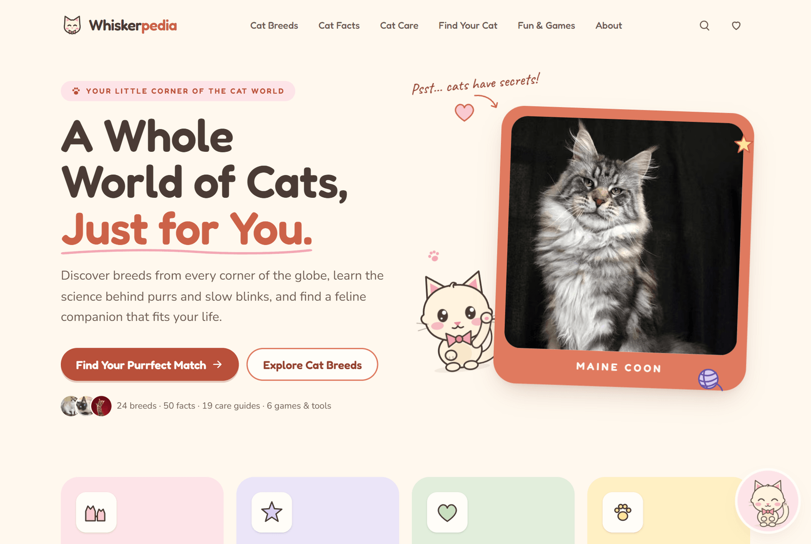
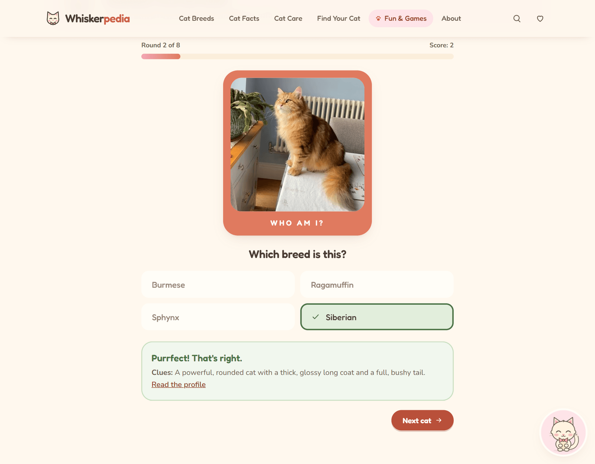

# Whiskerpedia

An illustrated, interactive cat encyclopedia: breed explorer and profiles, a fact-checked facts collection, a care library, a lifestyle-based breed-matching quiz, mini-games, favorites and site-wide search.

Built with **Next.js 16 (App Router)**, **React 19**, **TypeScript** and **Tailwind CSS 4**. There are no other runtime dependencies.

## Screenshots

**Homepage**, with Mochi the mascot peeking out from behind the featured breed:



**Guess the Breed**, mid-game, just after a correct answer:



To refresh these after design changes, run `node scripts/readme-screenshots.mjs` against a running production server.

## Getting started

```bash
npm install
npm run dev        # http://localhost:3000
npm run build      # production build (all pages except /search are statically generated)
npm start          # serve the production build
npm run typecheck
```

Set `NEXT_PUBLIC_SITE_URL` in production so canonical URLs, Open Graph tags and the sitemap use your domain.

### Tests

`scripts/e2e.mjs` runs smoke tests against a running server (quiz flow, filters, search keyboard navigation, favorites persistence, compare, every game, checklist, 404). It uses `playwright-core` with the locally installed Microsoft Edge, so no browser download is needed.

```bash
npm run build && npm start      # in one terminal
npm run test:e2e                # in another
```

`npm run screenshots -- <outDir> <width> / /breeds …` saves full-page screenshots and reports horizontal overflow.

## Renaming the brand

Everything brand-related lives in [`src/config/site.ts`](src/config/site.ts): name, mascot name, tagline, description, URL and the localStorage prefix.

## Project structure

```
src/
  app/                 Routes (home, breeds/[slug], compare, facts, care/[slug], care/checklist,
                       quiz, games/*, favorites, search, about, legal pages, sitemap, robots, OG image)
  components/
    illustrations/     CatPortrait (procedural breed art), Doodle icons, paw prints
    mascot/            Mochi artwork (8 poses), floating guide, message bus
    breeds/ facts/ care/ quiz/ games/ favorites/ search/ home/ layout/ ui/
  data/                Structured content: breeds, facts, care guides, quiz, games, checklist, sources
  lib/                 Matching engine, search index, storage, SEO helpers, color utils
```

## Content

| Dataset | Count | File |
| --- | --- | --- |
| Breeds | 24 | `src/data/breeds.ts` |
| Cat facts | 50 (each labelled *established*, *studied* or *theory*) | `src/data/facts.ts` |
| Care guides | 19 across 4 categories | `src/data/care.ts` |
| Trivia questions | 25 (10 per game, answers shuffled) | `src/data/games.ts` |
| Fact-or-fiction statements | 22 | `src/data/games.ts` |
| Cat of the Day characters | 10 | `src/data/games.ts` |

Breed health notes list conditions with published breed associations and always carry a "talk to your vet" caveat. Sources are linked on every breed page and care guide; study-specific facts link to the paper's DOI.

**Images:** each breed has a photo from Wikimedia Commons in `public/images/breeds/`, served responsively through `next/image`. Photo credits and licenses live in `src/data/photos.json` and appear under the photo on each breed page. `npm run images:fetch` downloads any missing ones and optimizes them. To swap a photo, run `npm run images:fetch -- siamese="File:Some photo.jpg"`; add a `position` (CSS `object-position`) in the JSON to adjust the crop. To use your own photo, drop it in `public/images/breeds/`, point that breed's `src` at it, and run `npm run images:optimize`.

**Image optimization:**

- `scripts/optimize-images.mjs` turns each source photo into a lean master: at most 1200×1500px, mozjpeg quality 82, EXIF orientation applied and metadata stripped. It also records width, height and a tiny blur placeholder in `photos.json`. It processes each file only once, so re-running it never degrades a photo; pass `--force` to redo everything.
- `next/image` then serves each visitor AVIF (WebP or JPEG as fallbacks) at the width their layout needs. Quality is 70 for photos and 60 for thumbnails, and optimized images are cached for 31 days (see `next.config.ts`).
- Only the first visible photo on a page (the homepage hero, the breed-page gallery) is preloaded. Everything else lazy-loads with a blur-up placeholder.
- `npm run images:weight` reports how many image bytes each page downloads on phone and desktop. Run it against a production server.

Mochi, Cat of the Day, the personality cards, the dream cat builder and each breed's alternate portrait are original SVG illustrations, generated from a small `CatLook` description (coat, pattern, eyes, ears, face, fluff). A breed without a photo falls back to its illustration automatically.

## The matching quiz

`src/lib/matching.ts` implements transparent weighted scoring:

- Each answer adds soft preferences (target value + weight) on dimensions such as activity, affection, playfulness, curiosity, chattiness, grooming and space. It can also weight household members (children, dogs, cats) or bonuses (fluffy, distinctive look).
- Grooming, chattiness and space answers are **limits**: breeds above the limit lose points; breeds below don't.
- Each breed scores 0–1 per dimension. The final score is the weighted average, shown as a "playful compatibility score".
- No single answer can exclude a breed. The Scottish Fold is never recommended because of the welfare problems linked to the ear fold, and mixed-breed cats get a separate adoption reminder.
- The results screen explains the top factors, lists commitments and challenges, and shows the full answer and score breakdown.

## Persistence

Favorites, checklist progress, the saved dream cat and the "hide mascot" choice are stored in `localStorage`, with every read and write wrapped so a blocked storage never breaks the page. No accounts, cookies or analytics.

## Not included (by design)

- **Newsletter signup:** omitted, because it isn't connected to a real service.
- **Social links:** shown as "coming soon" text rather than placeholder links.
